<p align="center">
  
</p>

<h1 align="center">FetchKosh</h1>

<p align="center">
  <b>Wi-Fi and mobile data, on the same download.</b><br>
  A download manager for Windows and Android that pulls one file over all your connections at once,<br>
  plays your files on your TV, and moves them between your phone and PC.
</p>

<p align="center">
  <a href="https://github.com/patilsiddhesh23/fetchkosh/releases/latest"></a>
  <a href="https://github.com/patilsiddhesh23/fetchkosh/releases"></a>
  <a href="#join-the-android-test"></a>
  <a href="https://fetchkosh.pages.dev"></a>
  
</p>

<p align="center">
  <a href="https://github.com/patilsiddhesh23/fetchkosh/releases/latest/download/FetchKosh-setup.exe"><b>⬇ Download for Windows</b></a> ·
  <a href="#join-the-android-test"><b>▶ Join the Android test</b></a> ·
  <a href="https://fetchkosh.pages.dev">Website</a> ·
  <a href="https://fetchkosh.pages.dev/#setup">Setup guide</a> ·
  <a href="https://fetchkosh.pages.dev/#faq">FAQ</a>
</p>

<p align="center">
  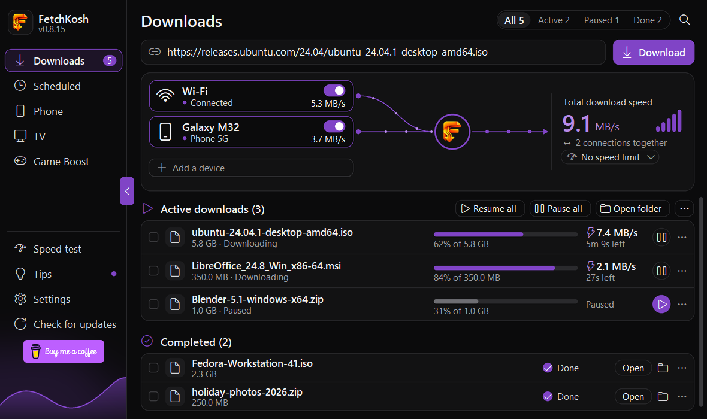
</p>

---

## How it works

FetchKosh splits a file into parts and fetches them over every connection you have at the same time. The faster connection takes more parts, and a slow one never holds up the end of the download.

<p align="center">
  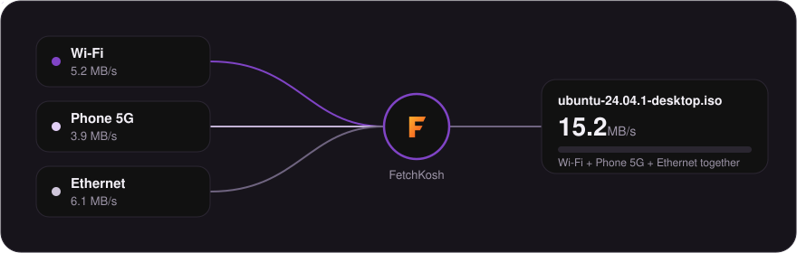
</p>

In our own test, a Steam game download went from **26.3 Mbps** over Wi-Fi alone to **42.9 Mbps** with the phone's 5G added. Your gain depends on your connections: with a single connection, the line's own speed is the limit.

---

## Windows

<table>
  <tr>
    <td width="50%">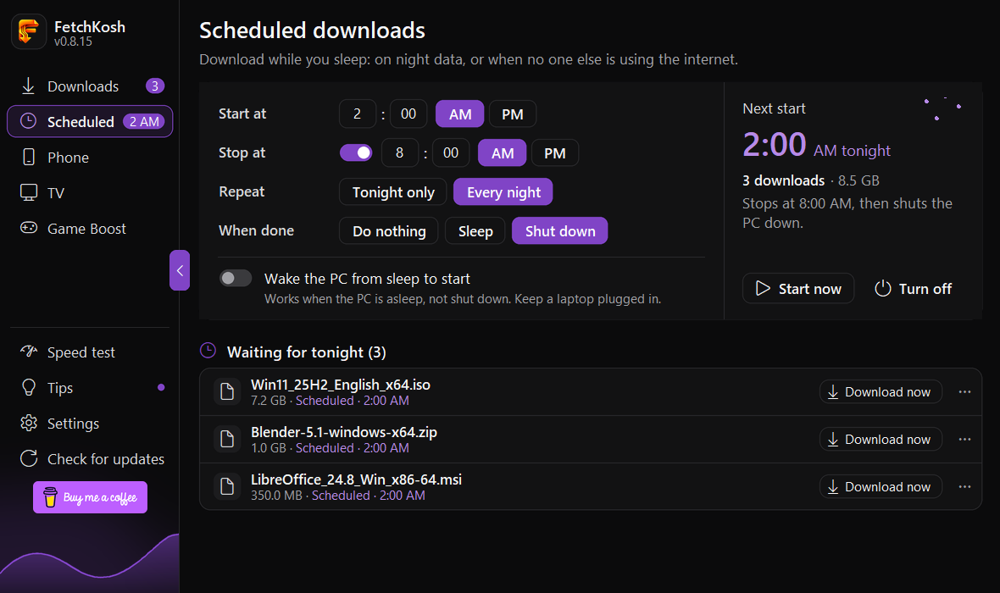</td>
    <td width="50%">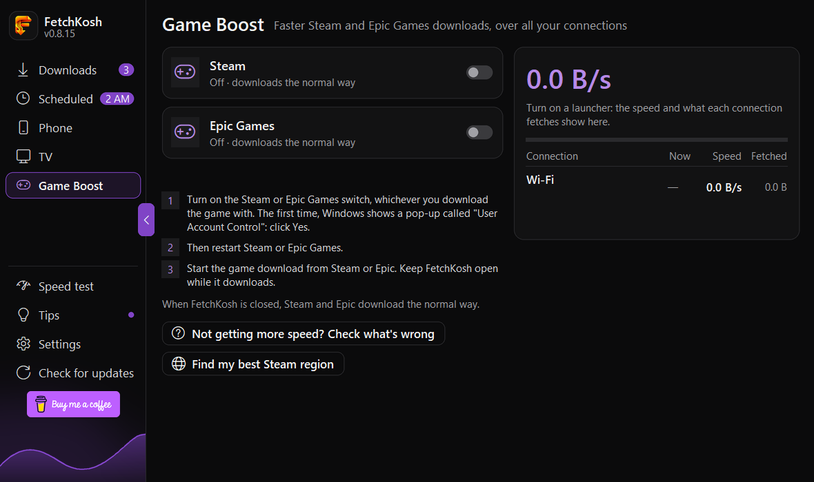</td>
  </tr>
  <tr>
    <td align="center"><b>Scheduled downloads</b><br>Start at 2 AM on night data, stop at 8, then sleep or shut down.</td>
    <td align="center"><b>Game Boost</b><br>Steam and Epic Games downloads over every connection.</td>
  </tr>
</table>

**Speed**
- **Every connection at once:** Ethernet, Wi-Fi, USB tethering, and your phone's 5G over Wi-Fi with the FetchKosh phone app. No hotspot to set up.
- **Auto parts per connection:** adds more parts while the speed keeps rising, and remembers what each site allows.
- **Game Boost:** Steam and Epic Games downloads over all your connections, from the fastest server for each one. Steam still installs the game as usual.

**Your data, your rules**
- **Daily data limit per connection:** give the phone, say, 1 GB a day. After that FetchKosh carries on over Wi-Fi, or pauses and continues the next day.
- **Speed limits:** for one connection or for everything, so others at home can still browse.
- **Scheduled downloads:** pick a start and stop time, and whether the PC sleeps or shuts down when done. It can wake the PC from sleep to start.

**Everyday**
- **Browser extension** for Chrome, Edge and Brave: click download in the browser and FetchKosh takes it, with "Download started" and "Download complete" notices.
- **Mini window:** a small card on top of your other windows shows each download, and says Completed when it's in.
- **Link expired? Keep going:** give FetchKosh a fresh link and it continues from where it stopped.
- **Check the file:** see a finished file's SHA-256 and compare it with the one from the website.
- **Download many:** paste a list of links, or `photo[001-100].jpg` for 100 numbered links.
- **Resumes after a crash or restart**, sorts files into folders by type, and warns before downloading the same file twice.
- **Updates itself** from this repository's releases.

<p align="center">
  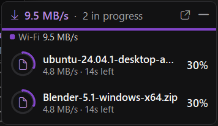
</p>

---

## Android and Android TV

<table>
  <tr>
    <td width="33%" align="center">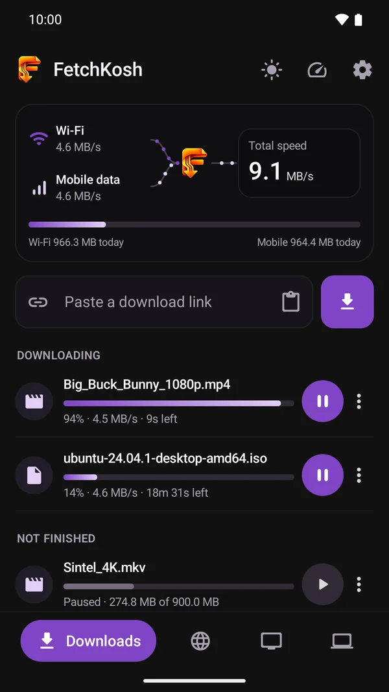</td>
    <td width="33%" align="center">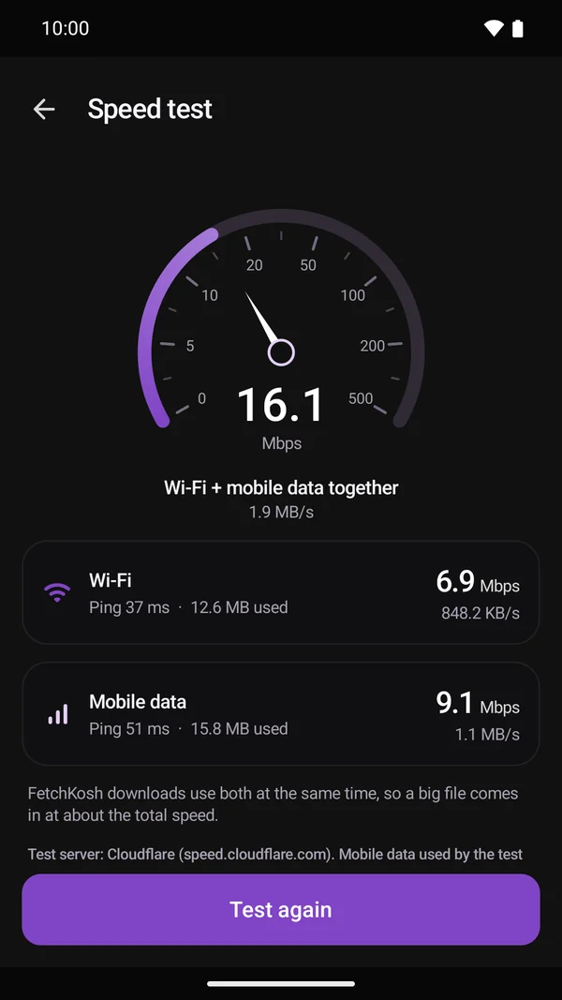</td>
    <td width="33%" align="center">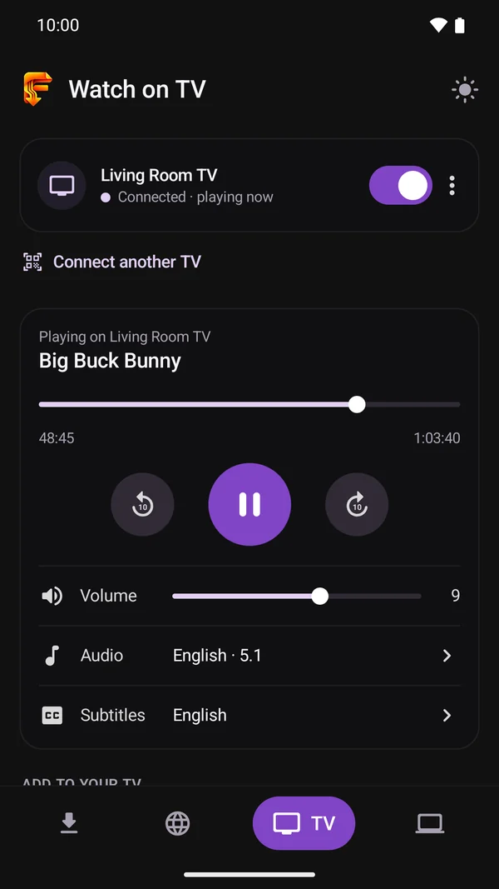</td>
  </tr>
  <tr>
    <td align="center"><b>Wi-Fi + mobile data</b></td>
    <td align="center"><b>Speed test</b></td>
    <td align="center"><b>Your phone is the remote</b></td>
  </tr>
</table>

- **Both connections on one download**, with a speed card that shows what each one gives you.
- **A daily mobile data limit**, a Wi-Fi-only switch, and night downloads, optionally only while charging.
- **Phone 5G for your PC:** lend the phone's mobile data to FetchKosh for Windows as one more connection.
- **Android TV:** play files from your phone or PC on the TV over home Wi-Fi, and control them from the phone.
- **Quick Settings tile and home-screen widget**, a built-in speed test, and pause or resume that survives a restart.

---

## Phone 5G for your PC

<p align="center">
  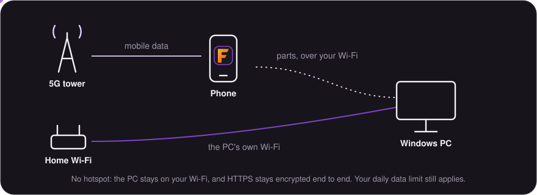
</p>

Your phone's mobile data becomes one more connection for the Windows app, with no hotspot to set up and no cable.

1. Install **FetchKosh on your phone** ([join the Android test](#join-the-android-test)), and keep the phone on the same Wi-Fi as the PC.
2. On the phone, open the **PC** tab and switch on **Phone 5G for your PC**.
3. The PC finds the phone by itself. **Pair once** with the code it shows.

From then on, the PC sends some parts of each download through the phone: the phone fetches them over its mobile data and hands them to the PC over your home Wi-Fi. The PC itself never leaves your Wi-Fi.

- **Secure:** HTTPS downloads stay encrypted end to end. The phone only passes the bytes on.
- **In your control:** the phone's daily data limit counts what the PC uses too, and the PC can limit the phone's speed or give it its own daily limit.
- **Only phones you approve** can connect, and you can remove one at any time.
- Lending mobile data to a PC works like a hotspot as far as your mobile plan is concerned, so check that your plan allows it.

---

## Game Boost for Steam and Epic Games

<p align="center">
  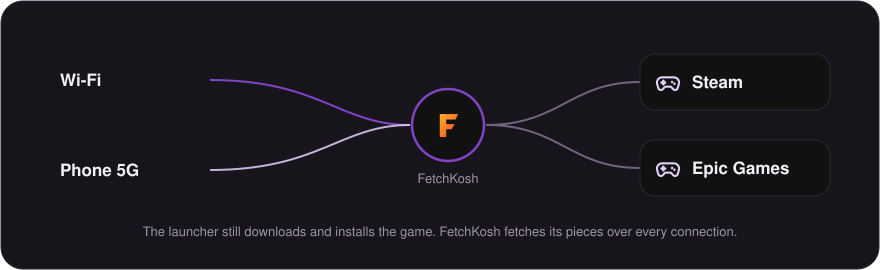
</p>

Steam and Epic Games download a game over one connection. Game Boost lets them use all of yours.

1. In FetchKosh, open **Game Boost** and switch on **Steam** or **Epic Games**. The first time, Windows shows a pop-up called **"User Account Control"**: click **Yes**.
2. **Restart** Steam or Epic Games.
3. **Download your game** as usual, and keep FetchKosh open while it runs.

**How it works:** while it's on, the launcher asks FetchKosh for the game's pieces instead of going straight to its servers. FetchKosh fetches those pieces over Ethernet, Wi-Fi and your phone's 5G at the same time, and the launcher downloads and installs the game exactly as it normally does.

- **The fastest server for each connection:** your Wi-Fi might fetch from one place and your phone's 5G from another.
- **Checked pieces:** each Steam piece is checked before Steam gets it, and a piece from a slow or failing server comes from another one without Steam noticing.
- **Find my best Steam region:** tests Steam's servers near you over each connection and tells you which download region to pick.
- **Not getting more speed?** The Game Boost tab's **Check what's wrong** looks for the usual causes.
- **Nothing stays changed:** switch it off, or close FetchKosh, and Steam and Epic Games download the normal way again.

In our test, a Steam download went from **26.3 Mbps** over Wi-Fi alone to **42.9 Mbps** with the phone's 5G added.

---

## Phone to TV: better than screen casting

<p align="center">
  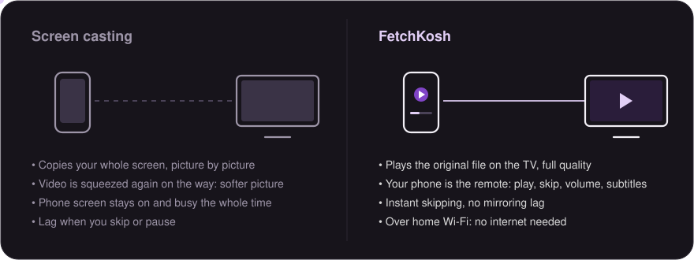
</p>

Screen casting copies your phone's screen to the TV, picture by picture. FetchKosh does something different: it sends the **file itself** to the FetchKosh app on your Android TV, and the TV plays it.

| | Screen casting | FetchKosh |
|---|---|---|
| **Picture** | Your screen, squeezed again on the way | The original file, full quality |
| **Skipping** | Lags behind your phone | Instant |
| **Your phone** | Its screen is the picture, so it stays busy | It's the remote: play, pause, skip 10 s, volume, audio and subtitles |

**From your PC too:** share a folder from the Windows app and pick what to watch on the TV.

**To connect:** the TV shows a code, and you scan it with your phone. Nothing to type. You can also keep a copy on the TV, or on a USB drive plugged into it.

<p align="center">
  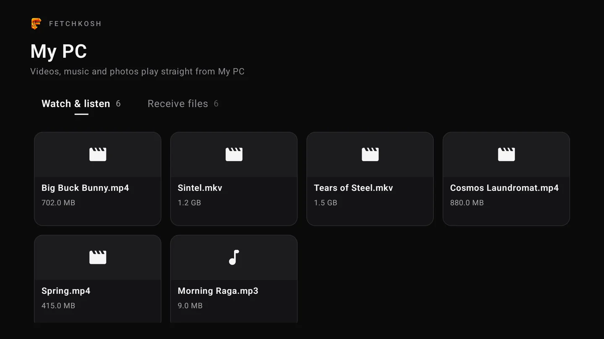
</p>

---

## Get FetchKosh

| Platform | Get it | Notes |
|---|---|---|
| **Windows 10 / 11** | [FetchKosh-setup.exe](https://github.com/patilsiddhesh23/fetchkosh/releases/latest/download/FetchKosh-setup.exe) | About 48 MB. Updates itself. |
| **Android phone** | [Join the test](#join-the-android-test) | Android 9 or newer. In testing on Google Play. |
| **Android TV** | Google Play on the TV | After joining the test with the same Google account. |
| **Browser extension** | Comes with the Windows app | In FetchKosh: **Tips → Add the browser extension**. |

### Join the Android test

FetchKosh for Android is in testing on Google Play. Joining takes a minute:

1. **Join the group** [kosh-tester](https://groups.google.com/g/kosh-tester) with the Google account you use on your phone.
2. **Become a tester:** open [play.google.com/apps/testing/com.kosh.fetchkosh](https://play.google.com/apps/testing/com.kosh.fetchkosh) and tap **Become a tester**.
3. **Install** [FetchKosh from Google Play](https://play.google.com/store/apps/details?id=com.kosh.fetchkosh). It can take a few minutes after step 2 before Play shows it.

Updates come through Google Play like any other app.

**Windows says "Windows protected your PC"?** Click **More info**, then **Run anyway**. Windows shows this once for new apps that aren't signed with a paid certificate yet.

**Check your download:** each release lists the SHA-256 of its installer, and the [website](https://fetchkosh.pages.dev/#get) shows the latest one. In PowerShell:

```powershell
Get-FileHash $HOME\Downloads\FetchKosh-setup.exe
```

---

## Support FetchKosh

FetchKosh is free. If it saves you time, a coffee keeps it going. Thank you!

<p>
  <a href="https://buymeacoffee.com/siddhesh23"></a>
</p>

<p>
  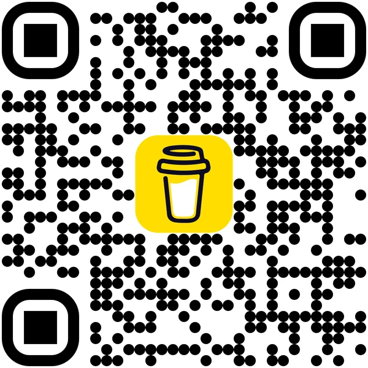<br>
  <sub>Or scan with your phone's camera.</sub>
</p>

---

<p align="center">
  <a href="https://fetchkosh.pages.dev/privacy">Privacy policy</a> ·
  <a href="https://github.com/patilsiddhesh23/fetchkosh/releases">Release notes</a> ·
  <a href="https://fetchkosh.pages.dev">fetchkosh.pages.dev</a><br>
  <sub>This repository holds the Windows releases and the website. Please only download files you have the right to download.</sub>
</p>
